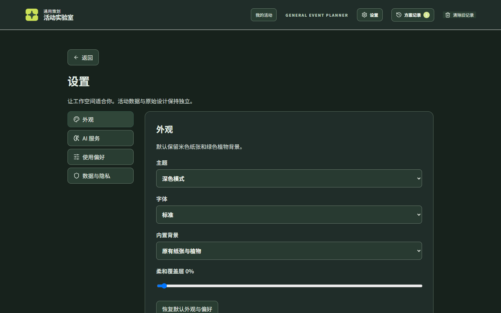
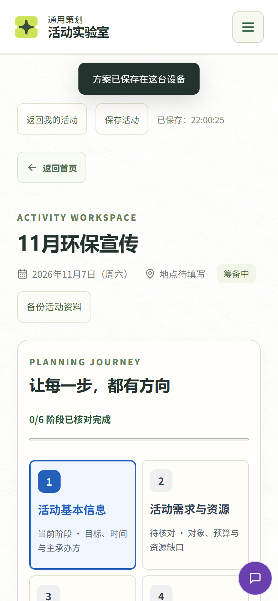
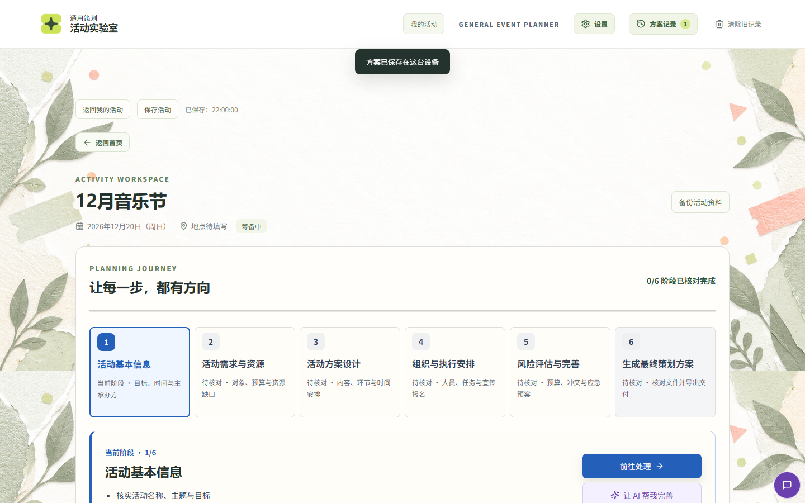

# 活动实验室（3MinLab）本地部署与产品复盘报告

- **项目路径**：`C:\Users\Lenovo\Documents\ChatGPT\3min labs\3MinLab`
- **仓库备份**：https://github.com/JasonChen911/3MinLab（`main` @ `950e83d`，190 个文件）
- **本地运行地址**：http://127.0.0.1:8787
- **测试日期**：2026-11-05
- **测试环境**：Windows 11 · Node.js v26.13.0 · Chromium Edge（Playwright 无头驱动）· 屏幕 1440×900 / 768×1024 / 390×844
- **代码状态**：`npm test` 全绿（前端 186 项 + 服务端 25 项），`npm run build` 通过

---

## 一、结论摘要

**一句话结论：这是一个功能完成度相当高、工程质量在同类"AI 策划工具"里偏上的产品，核心链路（一句话 → 12 模块方案 → 编辑 → 导出 → 项目留存 → 模拟推演）全部跑通且数据自洽；但"视觉可达性"和"首屏性能"两块存在明显短板，深色模式基本不可用，首屏接近 7 MB 且服务端零缓存、零压缩。**

| 维度 | 评价 | 说明 |
| --- | --- | --- |
| 功能完整度 | ★★★★☆ | 12 模块生成、需求假设标注、一句话改方案、应急调整、预算联动、导出、资料导入、模拟、复盘均已实现 |
| 数据一致性 | ★★★★☆ | 预算分项之和与合计完全相等；人数/岗位/物资按规模联动；导出文件为真实 OOXML/PDF |
| 工程质量 | ★★★★☆ | 规则引擎与 UI 分离、纯函数 + 211 项测试、服务端有 Host/Origin/体积/限流防护 |
| UI 视觉 | ★★★☆☆ | 纸张+植物风格统一、留白讲究；但信息密度过高、字号偏小、对比度不足 |
| 深色模式 | ★☆☆☆☆ | 首页在深色模式下几乎不可读（浅色纸张背景 + 浅色文字），无障碍违规 77 处 |
| 性能 | ★★☆☆☆ | 首屏 6.97 MB；Logo 887 KB 被下载两次；无 gzip / 无缓存头 / 不支持 304 |
| 移动端 | ★★★☆☆ | 无横向溢出、导航收进汉堡菜单；但工作台六阶段面板把主内容推到第 2 屏 |
| 无障碍 | ★★☆☆☆ | 对比度、字号、焦点可见性、弹窗焦点管理均有问题 |

**阻断级问题 2 个（P0）**：深色模式不可读；首屏体积与缓存策略。  
**重要问题 7 个（P1）**：移动端信息架构、对比度/字号、失效分享链接、焦点与弹窗、统计页串味、Toast 打扰、字号"大"无效。  
**一般问题 10 个（P2）**：见第五章。

---

## 二、备份与本地部署记录

### 2.1 GitHub 备份（改动前完成）

要求是"改之前先把任务文件全部上传备份"，因此第一步就做了全量快照，**未对项目源码做任何修改**（只是 `git add/commit/push`）。

```
commit 950e83d  backup: 2026-11-05 本地部署前完整快照（生命周期升级 + 模拟实验室 + 设置中心）
branch  main -> origin/main（04f5306..950e83d，快进，无需 force）
文件数  190（node_modules / dist / *.local 按 .gitignore 排除）
```

备份时发现三个环境事实，记录如下，便于下次复现：

1. 机器上原本**没有安装 git**，也没有 `gh` CLI；通过 `winget install Git.Git` 安装 Git 2.56。
2. 本机访问 GitHub 走**系统代理 127.0.0.1:7890**，`git push` 需要显式配置 `http.proxy`，否则报 `Failed to connect to github.com:443`；而 `api.github.com` 走系统代理是通的，容易误判为断网。
3. 仓库凭据已存在 Windows 凭据管理器（`git:https://github.com`），无需重新登录。

推送后已通过 GitHub API 复核：远端 `main` = `950e83d`，树内 190 个文件。

### 2.2 依赖与构建

```bash
npm install          # 依赖原本完整，"up to date"
npm run build        # tsc -b && vite build，通过
npm test             # 24 个 vitest 文件 186 项 + server 25 项，全部通过
```

构建产物：

| 产物 | 原始体积 | gzip |
| --- | --- | --- |
| `dist/assets/index-*.js` | 763.60 kB | 253.11 kB |
| `dist/assets/index-*.css` | 109.29 kB | 22.75 kB |
| `dist/assets/browser-*.js` | 25.78 kB | 10.13 kB |

构建告警：单 chunk 超过 500 kB（未做代码分割）。这不影响功能，但和首屏性能问题叠加。

### 2.3 运行

```bash
# 生产模式（当前正在运行）
API_PORT=8787 node server/index.mjs      # 或 npm start
# 开发模式（已验证可用：Vite 5173 + API 8789）
npm run dev
```

- 生产地址：**http://127.0.0.1:8787**（静态 `dist` + `/api/*`）
- 开发模式已实测：`5173` 返回 200，`8789/api/ai/config` 返回 200；验证后已关闭，避免与生产端口冲突。
- 无 `.env.local`，因此 `/api/ai/config` 返回 `configured:false`，**AI 相关功能全部走"本地规则降级"**——这恰好是本次要重点验证的路径。
- 旧部署实例（端口 8788，PID 9960）仍在运行，指向同一份 `dist`，重新构建后它也会读到新产物。

---

## 三、验证方法

| 手段 | 覆盖内容 |
| --- | --- |
| Playwright（Edge 无头）脚本化巡检 | 6 条路由 × 3 种分辨率；完整业务链路回归；截图存档 |
| axe-core（WCAG 2.1 A/AA 规则集） | 首页、需求页、工作台 5 个页签、项目页、设置页 |
| 接口探测（原始 HTTP + fetch） | Host/Origin 校验、Content-Type 校验、非法 JSON、路径穿越、限流、501 占位接口 |
| 二进制校验 | 导出的 Word/Excel 校验 `PK\x03\x04`，PDF 校验 `%PDF`，Markdown 行数与内容抽查 |
| IndexedDB 直读 | 校验自动保存是否真正落库（避免"界面看着保存了其实没存"的误判） |
| 键盘导航 | Tab 顺序、焦点可见性、弹窗焦点归属、Esc 关闭 |

共执行 20 个自动化脚本，关键结论均有两处以上交叉验证（例如"编辑是否持久化"先用 `innerText` 得到假阴性，改用"展开全部章节 + 读 input.value + 直读 IndexedDB"后确认真的是持久化的）。

---

## 四、功能验证结果

> 图例：✅ 正常 ｜ ⚠️ 可用但有体验问题 ｜ ❌ 失败

| # | 功能 | 结果 | 证据 / 说明 |
| --- | --- | --- | --- |
| 1 | 首页一句话输入、示例、字数上限（200） | ✅ | 超长自动截断；空内容禁用「开始策划」 |
| 2 | 12 个预设模板、10 类筛选、展开详情 | ✅ | 12 个预设均正常渲染；抽查「新生迎新」可直接起稿，Toast 正确回显预设名 |
| 3 | 一句话 → 需求结构化（人数/预算/日期/时长/场地/类型） | ✅ | "下个月给 400 名新生办校园迎新，预算 8000，在体育馆" → 400 人 / ¥8,000 / 2026-12-05 / 体育场馆 |
| 4 | 缺失信息按同类活动补全并标注「假设」 | ✅ | 时长、目标、人群均带「假设」标；界面逐条说明 |
| 5 | 无法判定类型时的类型询问 | ✅ | "办一个好玩的事情" → 出现 6 个快捷类型 + 「继续用通用框架」，不静默套模板 |
| 6 | 生成 12 模块方案 | ✅ | 12 章齐全，模块权重（重点/常规/简要）正确显示 |
| 7 | 预算分项与合计一致性 | ✅ | 1750+1200+1450+1450+950+1200 = ¥8,000 = 合计，占比合计 100% |
| 8 | 预算金额直接改，自动重算合计与占比 | ✅ | 改首行 → 合计从 50,000 → 44,999，复制文本同步 |
| 9 | 逐行编辑（标题、摘要、表格单元格、增删行） | ✅ | 编辑后刷新仍在（IndexedDB 已落库） |
| 10 | 一句话改方案（本地规则） | ✅ | "预算压缩到 5000" → 预览 50000→5000，勾选应用后预算变 ¥5,000，并写版本历史 |
| 11 | 应急调整（降雨/场地/缺人/设备/嘉宾迟到） | ✅ | 预览 → 应用 → 写入流程/执行/风险 → 可撤销 |
| 12 | 复制全文（Markdown）/ 复制招募文案 | ✅ | 剪贴板 8,935 字符，含最新编辑 |
| 13 | 下载 Markdown | ✅ | 8,565 B / 371 行，内容与页面一致 |
| 14 | 导出 Word / Excel / PDF | ✅ | 19,882 B（PK）/ 17,867 B（PK）/ 116,414 B（%PDF），中文正常 |
| 15 | 打印/存 PDF 样式 | ✅ | 打印样式会隐藏导航、展开全部章节、隐藏助手浮层 |
| 16 | 收藏 / 方案记录 / 历史打开 / 删除 | ✅ | 记录数、空态文案正确 |
| 17 | 项目自动保存、恢复、状态筛选、复制、归档、删除 | ✅ | 删除有二次确认；刷新后回到上次 #workspace/{id} |
| 18 | 完整备份导出 / 导入 | ✅ | 24,647 B JSON（format/version/project/files），导入后生成"（恢复副本）" |
| 19 | 上传 CSV / 解析预览 / 字段映射 / 确认导入 | ✅ | 3 行报名数据映射到「通用报名名单」，不执行公式 |
| 20 | 专属工具箱、生成文档、文档中心编辑、导出 | ✅ | 工具 6 个可添加；文档可生成并导出三种格式 |
| 21 | 人员与任务、数据统计、预算执行 | ⚠️ | 数据正确，但统计页出现"运动员/田径数据冲突"等与活动无关的指标 |
| 22 | 活动仿真（开始/暂停/单步/倍速/沙盘/决策/风险/任务表） | ✅ | 9 分钟模拟时刻：到场 77/300、签到 25/52、人员 3/27、风险事件因果链可见 |
| 23 | 敏感性分析（60 次） | ⚠️ | 必须先勾选"我已核对假设"，否则只在页面顶部提示"请先确认假设"，按钮附近无提示 |
| 24 | 现场指挥中心（签到/任务/支出/事件登记） | ✅ | 空数据不虚构；CSV 导入入口可用 |
| 25 | 智能分析（确定性规则 + 待核对清单） | ✅ | "已通过 5/14、严重 0、待核对 9"，明确声明"不是安全评分" |
| 26 | 活动复盘 + 生成复盘文档 | ✅ | 生成《活动复盘报告 v1 · 手动编辑》并落到文档中心 |
| 27 | 设置：主题（4 种）/ 字体 / 背景 / 覆盖层 | ⚠️ | 主题、覆盖层、背景生效；"大"字号对正文几乎无效（见 P1-7） |
| 28 | 设置：AI 服务（供应商/BaseURL/模型/临时 Key） | ✅ | 未配置时按钮禁用、文案解释清楚；密钥只进服务端内存 |
| 29 | 未配置 AI 时的降级 | ✅ | 按钮禁用 + "未配置 API Key，本地引擎已按假设补全信息" |
| 30 | URL 参数 `?preset=` / `?idea=&start=1` | ⚠️ | 有效 ID 正常；**无效 ID 会生成空标题方案**（见 P1-3） |
| 31 | 移动端导航（汉堡菜单） | ✅ | 4 个入口收纳，面板 358×234 |
| 32 | 三档分辨率无横向溢出 | ✅ | 390 / 768 / 1440 的 `scrollWidth` 均等于视口宽 |
| 33 | 接口安全（Host/Origin/大小/限流/占位） | ✅ | 伪造 Host→403、跨域 Origin→403、非 JSON→415、坏 JSON→400、`/api/ideas/convert`→501 |
| 34 | 静态资源缓存与压缩 | ❌ | 无 `Cache-Control`、无 `ETag`/`Last-Modified`、不支持 gzip（见 P0-2） |

---

## 五、问题清单

### P0-1　深色模式下首页几乎不可读

**现象**：切换到"深色模式"后，首页仍使用浅色纸张背景图，但文字颜色已切到浅色（`#e4eee5`），标题、正文、示例按钮全部糊在背景里；`#home` 一次扫描产生 **77 处对比度违规**（浅色模式同页为 64 处）。


**原因推断**：`settings.css` 里 `html[data-theme=dark]` 只覆盖了 `body`、卡片、按钮的颜色，没有覆盖首页 `.hero` 的背景图（`hero-paper-background.png`）与 `.hero-copy` 的文字；而设置页本身是纯色背景，所以设置页看起来是正常的（下图），容易漏测。



**影响**：深色模式是"设置"里的一级选项，用户一旦选中，首页基本不可用，属于功能性阻断。

**建议**：
1. 深色模式下隐藏/替换纸张背景（或叠加深色遮罩 `rgba(20,28,24,.88)`）；
2. 给 `.hero`、`.preset-*`、`.idea-examples` 明确深色背景与前景变量；
3. 增加一条回归：切主题后对 4 个路由跑 axe，违规数必须为 0。

**验收标准**：深色模式下首页、需求页、工作台、项目页、设置页 axe 对比度违规 = 0，且肉眼可读。

---

### P0-2　首屏 6.97 MB，服务端零缓存、零压缩

**实测**（`/#home`，无缓存冷启动）：

| 资源 | 传输体积 |
| --- | --- |
| `hero-paper-background.png` | 2,355 KB |
| `hero-planning.png` | 1,610 KB |
| `activity-lab-logo-v2.png` | 887 KB **×2 次** |
| `index-*.js` | 746 KB |
| `index-*.css` | 107 KB |
| 其余 webp 缩略图 | 约 380 KB |
| **合计** | **6,969 KB** |

三个叠加问题：

1. **图片未优化**：Logo 原图 1254×1254（887 KB），页面上只显示 40px；`hero-paper-background.png` 1672×941 却 2.3 MB；全部 PNG，没有 WebP/AVIF，也没有 `srcset`。全站 7 张图合计约 10 MB。
2. **同一张图下载两次**：顶栏与页脚各一个 ``，浏览器性能条目里记录了两次 887 KB 传输。
3. **静态服务没有缓存策略**：响应头只有 `Content-Type`，无 `Cache-Control`、无 `ETag`、无 `Last-Modified`；带 `Accept-Encoding: gzip` 请求 JS 也返回未压缩的 746 KB（gzip 后应为 253 KB）。

**影响**：弱网/移动流量下首屏要 5–15 秒；每次刷新都重新下载约 7 MB；流量成本高。这是当前产品最大的"体感"问题，也是 Lighthouse 分数的主要扣分项。

**建议**（按性价比排序）：
1. Logo 生成多尺寸（32/64/128）并转 WebP，预计 887 KB → 3 KB；
2. 纸张/插画背景转 WebP + 质量 80，预计 2.3 MB → 150 KB；
3. 页脚复用顶栏图片（缓存或改用一个 ``），或直接内联 SVG；
4. `server/index.mjs` 增加 `Cache-Control: public, max-age=31536000, immutable`（`/assets/*` 带 hash）、`max-age=604800`（`/images/*`），并支持 `ETag` + 304；
5. 启用 gzip/brotli（Node 原生 `zlib` 即可，或前面挂 Nginx）；
6. `vite.config.ts` 对 `react`/`lucide-react`/`docx`/`exceljs`/`pdfkit` 做 `manualChunks` 或动态 `import()`，把首屏 JS 从 746 KB 降下来。

**验收标准**：首屏传输 < 800 KB；重复访问 304 命中率 > 90%；Lighthouse Performance ≥ 80。

---

### P1-1　移动端：六阶段面板把主内容推到第 2 屏

**实测**（390×844）：工作区顶部到页签导航的距离 **1,630 px**，其中"PLANNING JOURNEY 让每一步，都有方向"面板单独占 **1,129 px**（约 1.3 屏）。用户从"我的活动"进入后，要滚过近两屏才能看到「活动概览 / 活动策划 / 智能分析 / 模拟与执行 / 活动复盘」。



**影响**：移动端首屏被"进度说明"占满，看不出这个页面能干什么；桌面端同样要滚一屏（工作区首屏几乎只有进度条和"当前阶段 1/6"）。

**建议**：
- 移动端把六阶段面板折叠为一行摘要（`0/6 已核对 ▾`），点击展开；
- 桌面端把它挪到右侧栏或"活动概览"卡片内，不与主 tab 抢首屏；
- 首屏优先给"活动基本信息 + 三个主操作"。

**验收标准**：390 宽下从进入工作区到看见主 tab 不超过 1 屏（≤ 700 px）。

---

### P1-2　小字号 + 低对比度（全站性问题）

**实测**：
- 首页有 **65 处**文字 < 12px，最小 10px；`preset-badge`（10px）、`preset-metrics`（11px）、`mini-label`（12px）。
- axe 对比度违规：首页 64 处、需求页 11 处、策划页 6 处、模拟页 12 处、项目页 3 处。
- 典型数值：

| 元素 | 前景 / 背景 | 对比度 | 要求 |
| --- | --- | --- | --- |
| `.preset-badge`（10px 粗体） | `#6f8a5c` / `#eef5e2` | **3.43** | 4.5 |
| `.preset-metrics`（11px） | `#6c8168` / `#f6f9f0` | **3.96** | 4.5 |
| `.preset-group-note`（12px） | `#8b9a88` / `#fffefb` | **2.94** | 4.5 |
| `.mini-label`（12px 粗体） | `#658158` / `#fffefb` | 4.3 | 4.5 |
| 点击区「清除旧记录」 | 95×19 px | 高度 19 | ≥ 24（WCAG 2.2）/ 建议 44 |


**影响**：项目的主要用户是学生社团/行政人员，常在投影、笔记本低亮度或户外使用；10–11px 的灰绿色标签在真实环境里几乎读不到。

**建议**：
- 建立字号梯度：正文 ≥ 14px，说明文字 ≥ 12px，标签 ≥ 11px 且加粗；
- 把 `#6c8168`、`#8b9a88` 等灰绿统一改深一档（目标 ≥ 4.5:1）；
- 「清除旧记录」「重新描述」等文字按钮加内边距，保证点击高度 ≥ 32px（移动端 44px）；
- 在 CI 里加 axe 对比度断言。

---

### P1-3　失效的 `?preset=` 链接会生成一份空方案

**复现**：访问 `http://127.0.0.1:8787/?preset=does-not-exist`

**现象**：
- 顶部 Toast：`已套用预设「」，下面的内容都可以修改`（标题为空）；
- 进入需求页后，"参与人群"变成"目标参与者"、"活动目标"变成一句通用文案，人数/预算/日期全部缺失；
- 没有任何"预设不存在"的提示，用户会以为自己点错了什么。

**影响**：分享链接是产品的重要传播路径（README 明确宣传 `?preset=`、`?idea=`），参数一错就产出一份"半残"草稿，且会被自动保存成项目。

**建议**：`createBriefFromPreset` 找不到 ID 时返回 `null`，`startFromPreset` 提示"预设不存在，已回到默认输入"并停留在首页；同时对 `?idea=` 增加最小长度与空值保护（目前 < 4 字符会忽略，行为正确，可保持一致）。

---

### P1-4　键盘焦点不可见、弹窗不接管焦点

**实测 1**：首页大输入框获得焦点后，`outline: none`、`box-shadow: none`、`border: 0`，**没有任何视觉变化**（截图对比空白）。


**实测 2**：打开「方案记录」弹窗后，`document.activeElement` 仍是触发按钮（`BUTTON 方案记录`），焦点没有进入弹窗，也没有焦点陷阱；Esc 可以关闭（这点正常）。

**影响**：纯键盘用户无法判断当前位置；屏幕阅读器用户在弹窗打开后仍会读到背后的页面。

**建议**：
- 全局 `:focus-visible { outline: 2px solid var(--accent); outline-offset: 2px }`，输入框用 `box-shadow: 0 0 0 3px rgba(49,88,60,.25)`；
- 弹窗打开时 `focus()` 到标题或第一个可交互元素，关闭时焦点归还触发按钮；
- 使用 `role="dialog" aria-modal="true"` + 简单焦点陷阱（Tab 循环）。

---

### P1-5　"数据统计"页对非田径活动显示田径指标

**复现**：音乐节 / 产品发布会方案 → 活动策划 → 数据统计。

**现象**：固定显示「运动员 0」「有效成绩 0」「团体积分」「当前未发现已检测范围内的**田径数据冲突**；正式规程仍需人工核查」——对一场音乐节来说完全是噪音。代码位置：`src/workbench/WorkspaceHub.tsx:152-154`，指标数组与文案是写死的。

**影响**：这是"AI 策划"类产品最伤信任的一类问题——用户会立刻怀疑"模板拼装、不懂我的活动"。

**建议**：按 `data.scene`（athletics / performance / 通用）切换指标集；无相关数据时整块隐藏，而不是显示 0；把"田径"字样换成中性的"数据一致性检查"。

---

### P1-6　每次自动保存都弹 Toast，遮挡标题区

**现象**：进入工作区后，任何一次字段变化都会触发 `方案已保存在这台设备` 的 Toast，位于页面顶部居中，正好压住工作区标题；连续编辑时会反复出现（截图中几乎每张都有）。

**影响**：打断阅读、遮挡内容，且"保存成功"属于低价值高频反馈，不需要弹窗级别的提示。

**建议**：只在保存**失败**时用 Toast；成功状态收敛到顶部已有的「已保存：21:59:21」小字（这个设计本身很好），或做 1 秒淡出的角落提示。

---

### P1-7　字号设置"大"对正文无效

**实测**：`html[data-font=large] :is(p,li,td,...) { font-size: max(1em, 16px) }`。因为多数正文本来就是 16px，选"大"后 `.hero-copy p` 仍是 16px、`h1` 仍是 32px，**几乎没有任何变化**；选"小"时正文从 16px → 14.4px（生效）。

**影响**：这是一个"看起来有、实际没有"的控件，对需要放大字号的用户（中老年组织者、视力不佳者）等于失效。

**建议**：改为整体缩放（`html[data-font=large]{font-size:18px}` + 全站 rem），或对 `h1~h4`、正文、表格分别给 1.15/1.1 倍，并在设置页提供实时预览。

---

### P2 级问题（建议排期但可接受）

| 编号 | 问题 | 说明与建议 |
| --- | --- | --- |
| P2-1 | 数字输入静默钳制 | 人数填 0 → 变 500，填 -5 → 变 1，填 999999999 → 变 200000，无任何提示；建议失焦时提示"已按 1–200000 调整"或显示校验错误 |
| P2-2 | 预算显示格式不一致 | 输入框显示 `50000`，摘要 chip 显示 `¥50,000`；建议输入框也加千分位或统一不加 |
| P2-3 | "单日时长 8 小时 + 1 天" 语义重叠 | 两个控件挨着，用户容易只改一个；建议合并为"总时长/天数"或加说明 |
| P2-4 | 活动类型是 36 项原生下拉 | 无搜索、无分组；建议改为带搜索的分组选择器（现有 10 类正好可做 optgroup） |
| P2-5 | 「已识别」标签过度自信 | 用户只说"400 名新生"，"参与人群=新生及家长"来自推断却标「已识别」；建议区分「识别」「推断」三档 |
| P2-6 | 项目卡片主体不可点 | 点卡片无反应，只有「继续编辑」按钮能进入；建议整卡可点 + hover 反馈 |
| P2-7 | 术语不统一 | 顶部同时有「方案记录」「清除旧记录」，页面里又叫「活动项目」「活动资料」「检查点」；建议统一为"活动项目 / 方案版本" |
| P2-8 | 未实现功能占据版面 | 「AI 转为策划 · 待接入」及 `/api/ideas/convert` 501，界面按钮灰但占一整条横栏；建议收到"更多"里或标注"即将上线" |
| P2-9 | 敏感性分析缺少就近反馈 | 未勾选"同意假设"时只有顶部一行"请先确认假设"，按钮旁边无提示；建议按钮禁用 + tooltip |
| P2-10 | 长方案默认全折叠 | 12 个模块默认收起，审阅要逐章点开；建议提供"展开全部 / 只看重点模块"开关 |

---

## 六、UI 与视觉审查

### 6.1 做得好的地方

- **风格统一**：纸张底纹 + 植物插画 + 墨绿主色，和"策划案/手账"的心智模型一致，比通用 SaaS 蓝更有记忆点。
- **层级清晰**：`REQUIREMENT CHECK` / `YOUR EVENT BLUEPRINT` / `PLANNING JOURNEY` 这类小标签把"英文眉题 + 中文标题"的节奏做得很好。
- **空态友好**：项目页、文档中心、人员表都有明确的空态文案与行动按钮，没有"白屏"。
- **关键数字前置**：需求页顶部的 `4 小时 · 400 人 · ¥8,000` 摘要非常好用。


### 6.2 主要问题

1. **首屏信息密度与主次**：工作区首屏被"六阶段进度"占满，真正的内容（12 模块）要往下滚。像 `05-plan-overview.png` 这样，第一屏几乎只有进度条和"当前阶段"。
2. **字号偏小、灰度偏高**：见 P1-2。设计稿上的灰绿在真实屏幕上非常"虚"。
3. **卡片套卡片**：工作台里 `wb-hub > wb-card > wb-section-heading` 多层白底卡片，边界弱，扫视成本高。
4. **按钮风格过多**：主按钮（深绿实心）、次按钮（描边）、文字按钮、紫色 AI 按钮、蓝色 tab 下划线、灰色 chip 同时出现，视觉噪音偏大。建议收敛为"主 / 次 / 文字"三级 + 一个 AI 强调色。
5. **右下角紫色悬浮助手按钮**固定遮挡内容（移动端尤其明显），建议滚动时半透明或收进底栏。




### 6.3 响应式

| 断点 | 结论 |
| --- | --- |
| 1440 | 布局稳定，无溢出；三栏表单舒适 |
| 768 | 无溢出；预设卡片两列正常；项目卡片间距偏松 |
| 390 | 无横向滚动；导航收进汉堡菜单；但六阶段面板过长（P1-1），悬浮按钮遮挡内容 |

---

## 七、性能

### 7.1 实测数据

| 指标 | 数值 |
| --- | --- |
| 首屏传输 | 6,969 KB |
| 其中图片 | 5,752 KB（82%） |
| JS（未压缩 / gzip） | 746 KB / 253 KB |
| CSS | 107 KB / 23 KB |
| DOMContentLoaded（本机） | 81 ms |
| 缓存策略 | 无 `Cache-Control` / 无 `ETag` / 不支持 304 |
| 压缩 | 未启用 gzip/brotli |

> 本机是回环网络，所以 DCL 只有 81 ms；真实网络下 7 MB 的体感延迟主要来自带宽，而不是 CPU。这也是为什么"本地测很快"容易掩盖问题。

### 7.2 优化优先级

| 优先级 | 动作 | 预计收益 |
| --- | --- | --- |
| 1 | Logo/背景图转 WebP + 多尺寸 | −5.5 MB |
| 2 | 静态资源加 `Cache-Control` + `ETag` + 304 | 二次访问 ≈ 0 请求体 |
| 3 | 开启 gzip（Node `zlib`） | JS/CSS −75% |
| 4 | `manualChunks` 拆分 docx/exceljs/pdfkit | 首屏 JS −40% |
| 5 | 图片 `loading="lazy"` + `srcset` | 首屏只加载可视区 |

---

## 八、无障碍（WCAG 2.1 AA）

| 检查项 | 结果 |
| --- | --- |
| 对比度 | ❌ 首页 64 / 需求 11 / 策划 6 / 模拟 12 / 项目 3 / 深色首页 77 |
| 图片替代文本 | ✅ 装饰图 `alt=""`，品牌图有 alt 语义（通过 `<a>` 文本） |
| 表单标签 | ✅ 输入框均有 `aria-label` 或 `<label>` |
| 键盘可达 | ✅ Tab 顺序合理（品牌 → 我的活动 → 设置 → 方案记录 → 清除旧记录 → 输入框 → 示例） |
| 焦点可见 | ❌ 输入框无焦点样式 |
| 弹窗焦点管理 | ❌ 打开后焦点不进入、无陷阱（Esc 可关） |
| 点击目标 | ⚠️ 「清除旧记录」95×19、「重新描述」100×26、部分复选框 18×18 |
| 状态播报 | ✅ 关键区域有 `role="status"` / `aria-live`（如修改预览、保存状态） |

---

## 九、内容与文案质量

**做得好的**：预算、岗位、物资的数量随人数联动；导出文档里的"估算值，不是报价"声明；模拟页反复强调"不代表真实发生概率"；复盘页坚持"无数据不虚构"。这些"边界声明"比同类产品克制得多。

**需要修的**：
1. 非田径活动出现"田径"字样（P1-5）。
2. 方案正文出现"具体场地待定"但仍写"体育场馆"，与工作台顶部"地点待填写"三处口径不一。
3. 自动命名"12月校园迎新 / 12月音乐节"缺少主题与主办方信息，作为导出文件名辨识度低。
4. `AI 转为策划 · 待接入` 与"组织者思路文档"入口放在策划页最上方，用户第一眼会以为核心功能不可用。
5. 类型下拉共 36 项（已核对无重复文案），但"展览/展会"与"展览/艺术展"相邻且语义接近，建议合并或补充说明。

---

## 十、改进路线图

### 第 1 周（阻断项）

| 序 | 事项 | 预估 | 验收 |
| --- | --- | --- | --- |
| 1 | 深色模式主题变量补全（首页/预设/卡片） | 4 h | 4 个路由 axe 对比度 0 违规 |
| 2 | 图片压缩 + WebP + 去重 | 3 h | 首屏 < 1.5 MB |
| 3 | 静态资源缓存头 + ETag + gzip | 3 h | 二次访问 304；JS 传输 253 KB |
| 4 | 字号/对比度统一调整 | 4 h | 正文 ≥ 14px，对比度 ≥ 4.5 |

### 第 2 周（体验项）

| 序 | 事项 | 预估 | 验收 |
| --- | --- | --- | --- |
| 5 | 移动端六阶段折叠 | 4 h | 390 宽下 1 屏内见主 tab |
| 6 | 焦点样式 + 弹窗焦点管理 | 3 h | 键盘可完整操作方案记录 |
| 7 | 失效 preset 兜底 | 1 h | 无效 ID 有提示且不建项目 |
| 8 | 统计页按场景切换指标 | 3 h | 音乐节不出现"运动员/田径" |
| 9 | Toast 收敛为失败提示 | 1 h | 正常保存无遮挡 |
| 10 | 字号"大"改为整体缩放 | 2 h | 三个档位肉眼可辨 |

### 第 3–4 周（打磨项）

11. 活动类型搜索/分组选择器；12. 数字输入校验提示；13. 预算千分位统一；14. 项目卡片整卡可点；15. 术语统一；16. 代码分割；17. CI 接入 axe + Lighthouse 门禁。

---

## 十一、附录

### A. 验证脚本

全部脚本位于 `C:\Users\Lenovo\Documents\deepseek-harness\default-workspace\.work\e2e\`：

`explore.mjs`（路由巡检）、`audit.mjs`（布局/axe）、`contrast.mjs`（对比度明细）、`flow-intake.mjs`、`flow-plan.mjs`、`func-plan*.mjs`（预算/复制/下载/修改/应急）、`func-workspace.mjs`（工具/文档/人员/统计）、`func-docs2.mjs`（导出/上传）、`func-import-sim.mjs`（导入/模拟）、`func-projects*.mjs`（项目/设置）、`check-content.mjs`（内容一致性）、`check-persist*.mjs`（持久化）、`check-edit*.mjs`（表格编辑）、`check-analysis.mjs`、`check-journey.mjs`、`check-dark-numbers.mjs`、`check-ux.mjs`、`check-focus.mjs`、`check-tab.mjs`、`check-weight.mjs`、`check-compress.mjs`、`api-check.mjs`、`api-host.mjs`。

### B. 截图清单

| 文件 | 说明 |
| --- | --- |
| `img/01-dark-home.png` | 深色模式首页（P0-1） |
| `img/02-dark-settings.png` | 深色模式设置页（正常，便于对比） |
| `img/03-mobile-journey.png` | 移动端六阶段面板（P1-1） |
| `img/04-mobile-home.png` | 移动端首页（正常） |
| `img/05-plan-overview.png` | 工作区首屏 |
| `img/06-intake.png` | 需求确认页 |
| `img/07-plan-tab.png` | 策划方案页 |
| `img/08-focus-textarea.png` | 输入框无焦点样式（P1-4） |
| `img/09-documents.png` | 文档中心 |
| `img/10-materials.png` | 活动资料 |
| `img/11-simulation.png` | 仿真实验室 |
| `img/13-import.png` | CSV 字段映射导入 |
| `img/15-history.png` | 方案记录弹窗 |

### C. 复现命令

```bash
cd "C:\Users\Lenovo\Documents\ChatGPT\3min labs\3MinLab"
npm install && npm run build && npm test
API_PORT=8787 node server/index.mjs     # http://127.0.0.1:8787

# 备份（如再次需要）
git add -A -- . ':!local-server*.log'
git commit -m "backup: ..." && git push origin HEAD:main
```

### D. 一句话总结

**底子很好——规则引擎可解释、导出是真的、数据是自洽的、边界声明是克制的；现在缺的是"让更多人能看清、能打开"的最后一公里：深色模式、首屏 7 MB、字号与对比度、移动端信息架构。**
